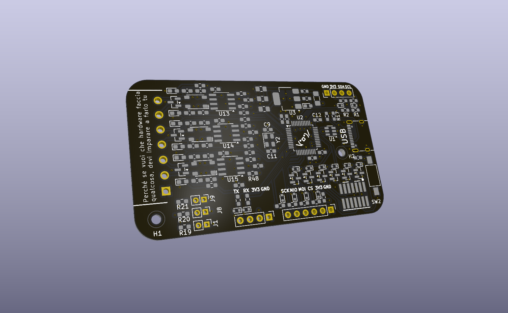
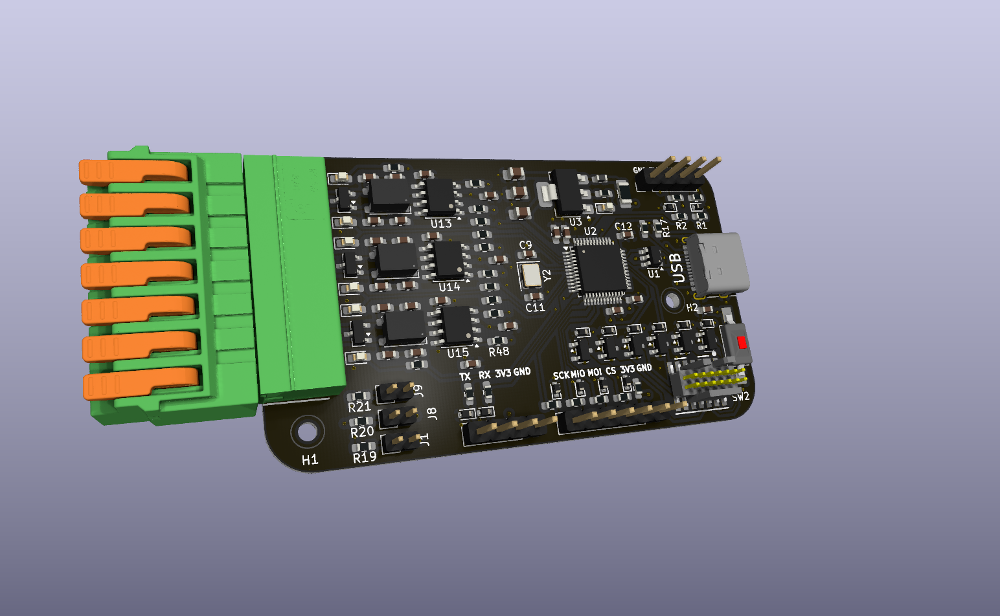
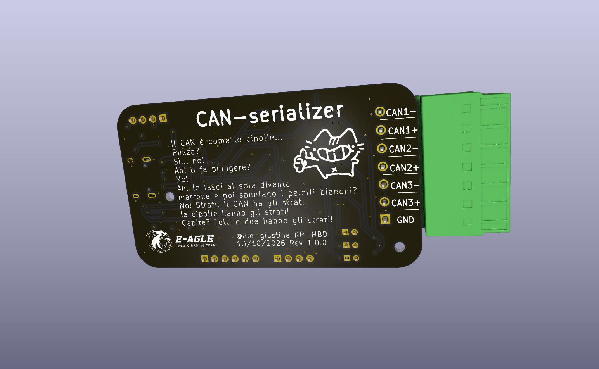

# CAN Serializer

A simple board that can be used to read up to 3 FDCAN bus lines using three filtered MCP2562FD with toggleable 120ohm termination resistors. Everything is hooked up to a STM32G473CCTx that is then hooked up to a USB-C receptacle. 

The board also features a USART interface, an SPI interface and an I2C interface for casual sensor debugging.

To connect to the can line a 1848943 1803329 PHOENIX CONNECTORS connector pair has been choosed for ease of operability.

A sample .ioc has been provided for the CUBEMX configuration.

# Board images

# Warning
The BOOT0 pin has been overriden due to the presence of 3 FDCAN transceivers. This means that the board will not boot correctly. Before programming one needs to set the correct register through the SWD interface to ignore the BOOT0 pin.
